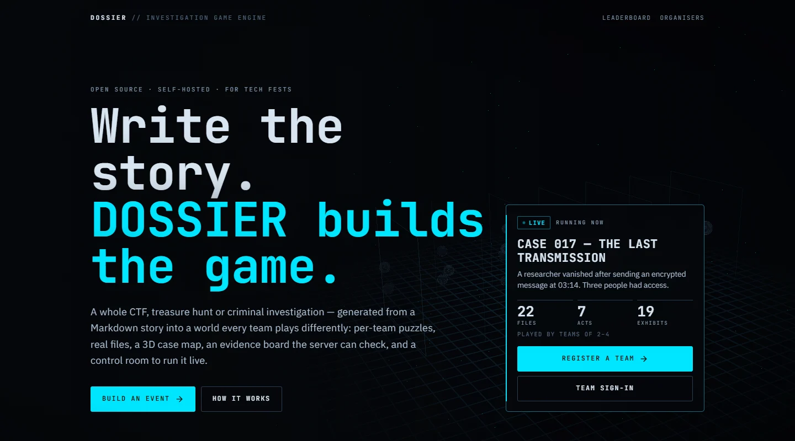
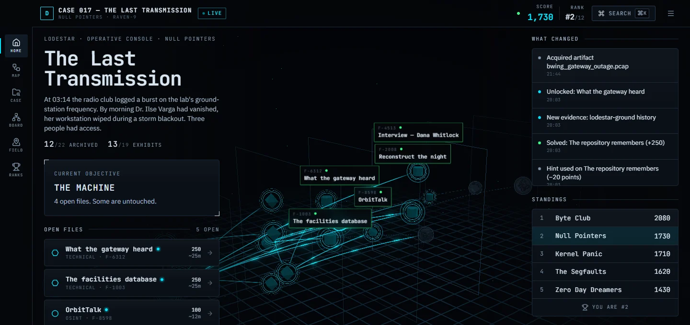
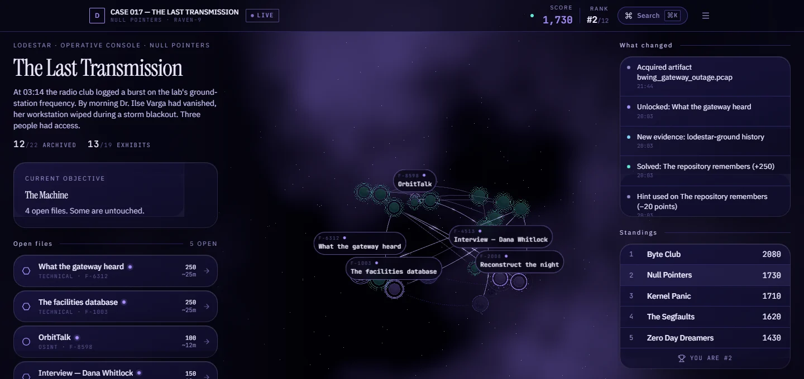
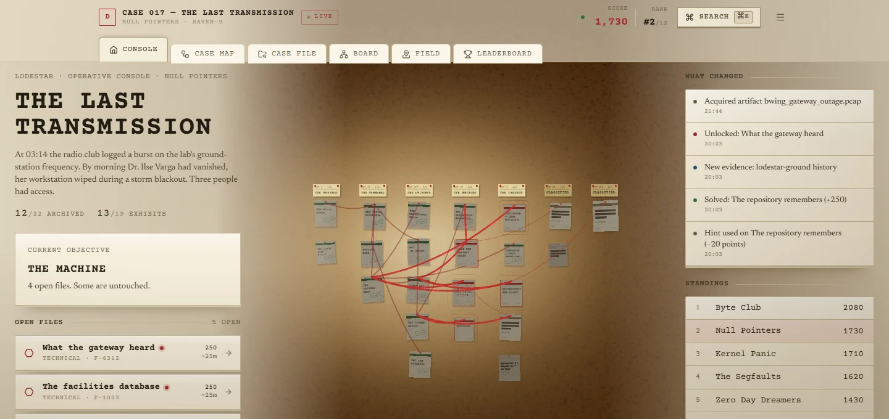
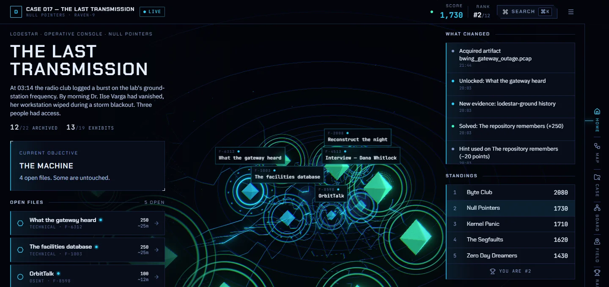
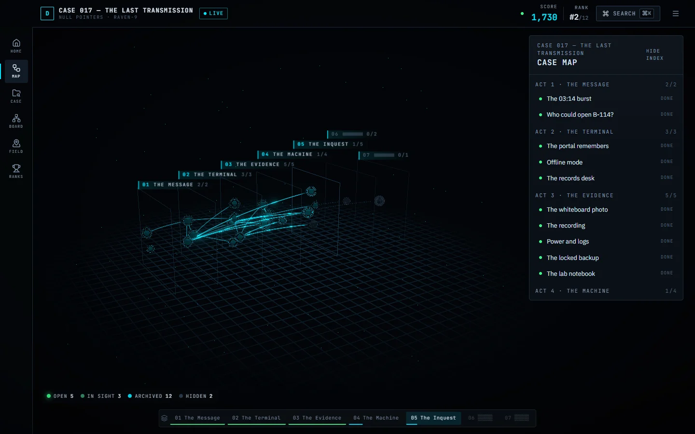
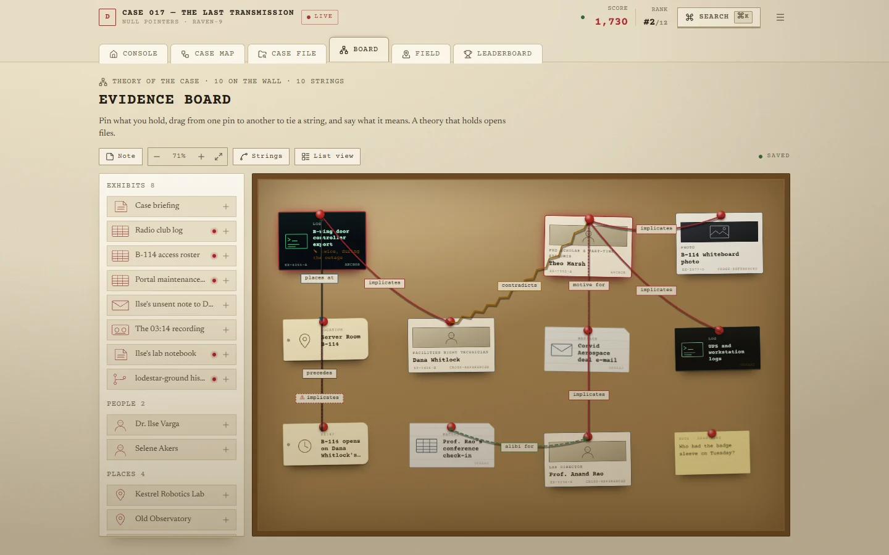
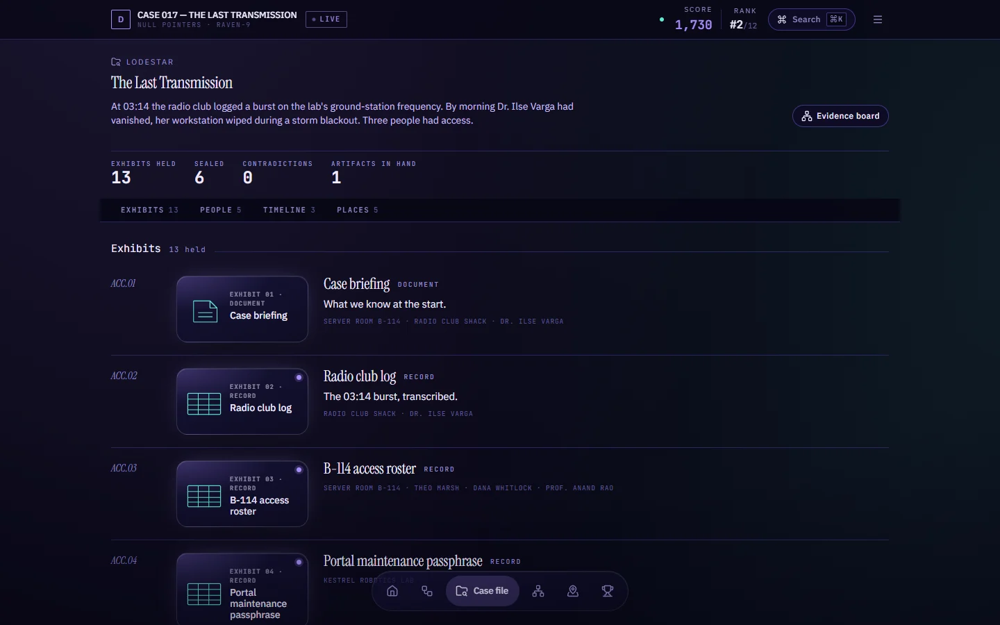
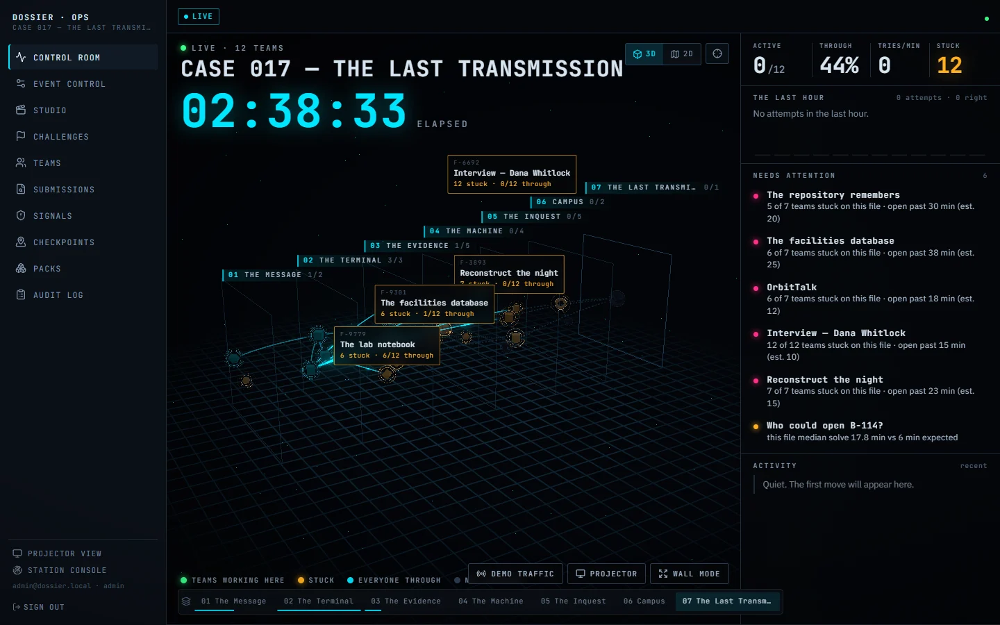
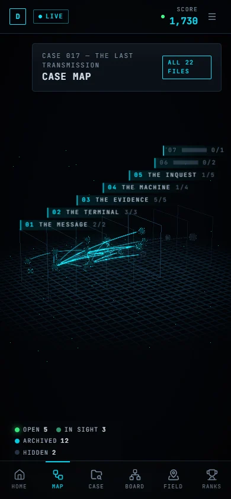

<div align="center">

# DOSSIER

### Write the story. DOSSIER builds the game.

An open-source, self-hosted engine for tech-fest competitions: CTFs, treasure hunts and criminal
investigations, generated from a Markdown story into a world every team plays differently.

[Quick start](#quick-start) · [Write your own case](#write-your-own-case) · [How it works](#how-it-works) · [Self-hosting](#self-hosting) · [Docs](#documentation)



</div>

---

## What it is

Most competition platforms are a list of questions and a flag box. In DOSSIER, an organiser writes a story:
people, places, a timeline, what really happened. DOSSIER compiles it into a **challenge graph** of 20–40
linked files that players investigate with real tools. Each team gets **its own instance** of the case:
different badge numbers, keys, timestamps, files and answers, built from the same structure, so answers
can't be passed between teams.

| | |
| :-- | :-- |
| **Players** | A cinematic opening, a **3D case map** built from the real challenge graph, a workstation for every kind of clue (cipher desk, sandboxed intranet, forensics bench, git repository, packet capture, SQL console, interrogation room), an **evidence board** of exhibits joined by typed strings, and a case file laid out like a table. |
| **Organisers** | **DOSSIER Studio**, a seven-step production line: *story → world → challenges → logic → presentation → playtest → publish*. Watch the world get built from its real build receipt, pick one of four looks, playtest as a team, publish. |
| **Operators** | A **Control Room** showing every team on the same map, stuck files highlighted, what needs attention now, a live activity feed, wall mode for a projector, volunteer station consoles and a public standings display. |
| **Developers** | A typed primitive contract, a story compiler, a Zod blueprint schema, a publish-time validator with synthetic solvers, an event-sourced journal and a large test suite. |

### One case, four worlds

The theme is chosen per event. It changes navigation, typography, surfaces, the map, the evidence board,
the case file and the opening. It never changes a rule, a score or an answer.

| BLACKSITE | NEURAL ARCHIVE |
| :-: | :-: |
|  |  |
| *Operational and classified: graphite slabs, tactical layers, a side rail.* | *Archival and analytical: frosted glass, a constellation of memories, a floating dock.* |
| **COLD CASE** | **SIGNAL** |
|  |  |
| *Physical and tactile: paper and cork, a pinned wall, folder tabs.* | *Transmission and static: an oscilloscope, a tunnel of waveforms, a tuner strip.* |

### Inside a case

| The case map | The evidence board |
| :-: | :-: |
|  |  |
| **The case file** | **The Control Room** |
|  |  |



**Built for phones too.** Every player screen works down to 360px wide. The 3D map falls back to an
equivalent flat map with reduced motion, on weak GPUs or slow connections, and the evidence board has a list
view for small screens.

The flagship demo, **CASE 017: The Last Transmission**, is a seven-act case covering cryptic clues, a
sandboxed intranet, a signed session cookie, image, audio and PDF forensics, an encrypted ZIP, a git
repository with a dangling commit, a packet capture, a facilities database, an OSINT trail, three interviews
with contradictions, a timeline, an evidence board, QR and GPS checkpoints and a scored final reconstruction.

<br clear="right">

---

## Quick start

You need **Node ≥ 22** and **pnpm ≥ 10**. No database server is required: development uses PGlite, an
in-process Postgres.

```bash
git clone https://github.com/prorm/DOSSIER.git
cd DOSSIER
pnpm install
cp .env.example .env                          # placeholder secrets are fine outside production

export DATABASE_URL=pglite://.data/pglite     # PowerShell: $env:DATABASE_URL="pglite://.data/pglite"
pnpm demo                                     # seeds CASE 017, 150 min into the event, 12 simulated teams
pnpm dev                                      # http://localhost:3000
```

| Where | Sign in |
| :-- | :-- |
| Player console: `/login` | a demo team, e.g. `Null Pointers` / `demo-password`, or register a new team at `/register` |
| Studio `/studio`, Control Room `/admin` | `admin@dossier.local` / `dossier-demo-pass` |
| Volunteer station: `/volunteer` | `volunteer@dossier.local` / `dossier-demo-pass` |
| Projector: `/display` | a staff session, or the display link from Admin → Event control |

The simulator plays the demo teams through the real engine (intended solutions, varied pace, a few wrong
guesses and hints), so the Control Room, leaderboard and projector show a believable event. In the Control
Room, **Demo traffic** keeps those teams moving while you present. Re-running `pnpm demo` re-winds the
clock. The scripted 90-second walkthrough is in [`docs/DEMO.md`](docs/DEMO.md).

> **Tip.** A first visit plays the opening cinematic once per team per browser. Use a private window to
> see it again, or *team menu → Replay the opening*.

---

## Write your own case

### 1. Write a story

Save a Markdown file. The importer understands these headings and mines the prose for names, places and
times:

```markdown
# The Vanishing Prototype

The robotics lab's prototype disappeared during demo night. Power flickered at 21:40.

## Characters
- **Asha Rao** — lab manager. Found the empty safe.
- **Victor Hale** (suspect) — investor. Motive: the prototype would sink his company.
- **Lena Brooks** (suspect) — engineer who fought over credit for the design.
- **Sam Ortiz** (suspect) — night technician on duty.

## Background
Victor Hale funded the lab last year. Sam Ortiz borrowed Asha Rao's key card.

## Locations
- **Prototype Lab** — where the safe is.
- **Server Room** — door logs and camera feeds.

## Timeline
- 20:00 — Demo night begins.
- 21:40 — Power flickers in the east corridor.
- 21:41 — The lab door opens for nine seconds.

## Truth
- Culprit: Victor Hale
- Motive: keep the prototype off the market
- Method: used the borrowed key card during the power flicker
- Location: Prototype Lab
- Time: 21:41
```

Mark at least two characters `(suspect)`, name the culprit exactly as in *Characters*, and write timeline
items as `HH:MM — event`. Sparse stories give warnings rather than failures, and everything extracted can be
edited in Studio. Synonyms work too: *Cast*, *People*, *Places*, *Chronology*, *Solution*, *Evidence*, *Acts*.

### 2. Build it in Studio

1. Sign in as staff, open **/studio** and choose **Create new event**.
2. **Story**: drop in your `.md` files (or paste), then **Compile story**. Or click **Try a sample story**.
3. **World**: pick and order the rounds, choose a difficulty curve, then **Generate**. The build replays from
   its real receipt and lands on *This is the world you just created*.
4. **Presentation**: choose a theme, preview the opening, then **Save look**.
5. **Playtest**: run the 19 compiler checks, then **Open playtest** to play it as a private test team.
6. **Publish**: turn on **go live**, **Publish**, then **Start the event now**. Teams register at
   `/register`; you watch from `/admin`.

> Publishing with *go live* makes your event the active one. To return to the demo, open CASE 017 in
> Studio → **Publish** → **Activate**.

### Not only murder mysteries

The generator is built around a mystery (it always has a hidden "who, why, how, where, when"), but the files
players open are puzzles, and the round mix is yours:

| Round | What players do |
| :-- | :-- |
| Cryptic | ciphers and wordplay keyed by earlier answers |
| Browser | inspect a generated intranet: headers, cookies, storage, IndexedDB, service worker, source maps |
| Forensics | images, audio, PDFs, logs, archives and email with hidden evidence |
| Technical | CTF-style: git history, packet captures, a sandboxed SQL database |
| OSINT | a generated public trail of profiles and posts |
| Inquest | interviews, contradictions, timelines and the evidence board |
| Field | QR and GPS checkpoints around the venue |
| Final | the reconstruction, with partial credit per element |

Drop *Inquest* and *Final* and you get a story-driven CTF or treasure hunt. For a plain CTF or hunt with no
story at all, write a **pack** by hand ([below](#packs)).

---

## How it works

```
 story/*.md ──► Story compiler ──► Mapper ──► Planner ──► Blueprint v2 (Zod)
                (characters, places,  (concept →   (rounds × curve   │
                 timeline, truth)      mechanic)    → node graph)    ▼
                                                   Validator + synthetic solvers ──► publish (versioned)
                                                                                       │
   team action ─► dispatch() ─► primitive.validateAction/applyAction ─► journal events ─┤
                     ▲                (pure, deterministic)             (append-only)   │
                     │                                                                  ▼
               per-team world  ◄── instanceSeed(ANSWER_SECRET, event, team, scope)   GameState = fold(journal)
               (facts, artifacts,                                                      │
                sites, SQL sandbox)                                                    ▼
                                                         scores view · leaderboard · Control Room · SSE
```

- **Next.js 16** App Router, React 19, Tailwind; **Drizzle ORM** on **Postgres** in production or
  **PGlite** for development and tests. Three.js (React Three Fiber) draws the case map; the rest is DOM and SVG.
- **Blueprint v2** (`src/server/game/core/blueprint.ts`) is the single, versioned source of truth: event,
  story, world facts, acts, rounds, nodes, evidence, relations, red herrings, sites, checkpoints, hint
  economy and difficulty curve.
- **World facts and templates.** `{{badgeId}}`, `{{codeword | atbash}}`, `{{wipeTime | addmin:-330}}`.
  Facts come from a keyed per-team seed and flow between nodes, so multi-step chains are real data
  dependencies rather than labels.
- **Gates**: `node`, `all`/`any`/`atLeast`, `evidence`, `flag`, `score`, `resource`, `checkpoint`,
  `after`/`before`, `phase`, `links` (the evidence board), `discovery`, `hidden`.
- **Event sourcing.** The team journal is append-only (enforced by a DB trigger); state is a fold of the
  journal, and tests assert that the snapshot equals a full replay.
- **Realtime** uses SSE with a polling fallback that works behind campus firewalls.
- **The experience layer cannot change the game.** Themes, the 3D map, openings and per-team cosmetic
  variation read a player-safe projection of state: no hidden titles, no answers, no other team's data.

### Game primitives

Primitives are trusted server code; authored or generated content reaches them only as schema-validated
config, and every one is deterministic given its config and the team's seed.

| Primitive | Family | What the player does |
| :-- | :-- | :-- |
| `cryptic` | cryptic | Multi-step ciphers (Atbash, Vigenère, rail fence, base32, Morse…) keyed by earlier answers |
| `web-investigation` | browser | Explores a generated intranet with the browser's developer tools |
| `session-state` | browser | A signed synthetic session cookie and a clearance flow |
| `image-forensics` | forensics | Real PNG/JPEG with EXIF, text chunks and LSB-hidden data |
| `audio-forensics` | forensics | WAV with Morse, DTMF or a message drawn in the spectrogram |
| `pdf-forensics` | forensics | PDF with metadata, redaction layers and incremental content |
| `file-forensics` | forensics | Logs with clock drift, ZipCrypto archives, EML with attachments |
| `git-forensics` | ctf | A real git repository with rewritten history, reflog and a dangling commit |
| `network-capture` | ctf | A real `.pcap` of a field unit's beacons to reassemble |
| `sql-investigation` | ctf | A per-team read-only database (badge swipes × Wi-Fi × devices) |
| `osint-trail` | osint | A generated public trail of profiles and posts |
| `timeline` | inquest | Order events across clocks and time zones |
| `interview` | inquest | Question suspects, confront them with evidence, expose contradictions |
| `board-deduction` | inquest | Link evidence with a typed relation vocabulary; anti-guessing |
| `qr-checkpoint` | physical | Scan a team-scoped, expiring QR, optionally volunteer-confirmed |
| `gps-checkpoint` | physical | Check in within a radius of a location |
| `final-reconstruction` | final | Culprit, motive, method, place, time and proof, with partial credit |
| `static-answer` | custom | Classic question and answer |

Every generated artifact is verified with real tooling in the test suite (`unzip -P`, `git fsck`, `ffmpeg`,
PIL, pcap parsing with checksums).

### Validation on publish

- **Structure**: every config is valid for its primitive, references resolve, every node is reachable, no
  cycles, and the critical path has no dead end.
- **Solvability**: a playthrough bot solves every node for several sample teams through the real reducer.
- **Answer secrecy**: no answer leaks into views, sites, bundles or source maps, in any common encoding.
- **Variation**: per-team seeds actually vary the answers.
- **Content and pacing**: hints don't give answers away early, red herrings are falsifiable, checkpoints are
  configured, and the duration fits the event.

---

## Packs

A pack is a folder in `packs/` that defines an event by hand, which suits a plain CTF or treasure hunt.

- [`packs/minimal-ctf`](packs/minimal-ctf): a three-flag CTF and the template to copy.
- [`packs/demo-cyber-heist`](packs/demo-cyber-heist): hunt, CTF, inquest and live checkpoints in one event.
- [`packs/case-017`](packs/case-017): the complete 22-node flagship case as a v2 blueprint (`dossier.yaml` +
  `story/*.md`).

```yaml
- id: hexed
  mode: ctf
  category: crypto
  title: Hexed
  points: 100
  body: "`464c41477b6865787d` — decode me."
  answer: { type: flag, accept: ["FLAG{hex}"] }
  hints:
    - { cost: 20, text: "Each pair of characters is one byte." }
```

```bash
pnpm pack:validate <slug>   # full compiler validation, incl. playthrough and leak scan
pnpm pack:import <slug>     # validate + publish (+ activate unless --no-activate)
pnpm pack:export <id>       # any event → a pack folder
```

Packs run on the same engine, so they get the same themes, case map, Control Room and projector.

---

## Security model

- **Answer secrecy**: primitives split `public` from `secret`; only `view()` output reaches a browser.
  Static answers are stored as HMAC hashes, and every published blueprint is scanned for leaks.
- **Per-team determinism**: `instanceSeed(ANSWER_SECRET, eventId, teamId, scope)`, so answers can't be shared
  between teams or derived without the server secret.
- **Synthetic sandbox only**: every site, cookie, token, file, database and capture is generated for the
  team. Nothing touches real accounts or external targets. Sandbox sites are served under signed, team-bound
  `/x/<token>/` URLs with their own CSP; set `SANDBOX_URL` to a separate hostname in production.
- **SQL sandbox**: a per-team read-only PGlite in a worker thread, with statement guards, a row cap and a
  hard timeout.
- **Platform**: CSRF tokens and same-origin checks, httpOnly sessions, separate rate limits for answers and
  exploration, append-only journals (DB triggers), an audit log, suspicious-signal detection, and a
  production start-up refusal on weak or placeholder secrets.

---

## Self-hosting

```bash
# Generate secrets (repeat for SESSION_SECRET, ANSWER_SECRET, TOKEN_SECRET)
node -e "console.log(require('crypto').randomBytes(48).toString('base64url'))"

cp .env.example .env          # fill in the secrets and APP_URL; optionally SANDBOX_URL
docker compose up --build -d  # Postgres 17 + app; migrations run on boot and ACTIVE_PACK is imported
```

- Docker images use `node:22-alpine` and the Next.js standalone output.
- `DATABASE_URL=pglite://…` runs without Postgres, in a single process only (development and small demos).
- Tuning: `SQL_SANDBOX_MAX`, `SQL_SANDBOX_TIMEOUT_MS`, `WORLD_CACHE_MAX`, and `TRUST_PROXY` (only behind a
  proxy that sets `X-Forwarded-For`).
- Create staff with `pnpm staff:create`; `pnpm db:seed` creates an owner account and prints its password once.
- Display knobs: `?fx=off|low|mid|high` sets how much spectacle a device gets. Save-Data and 2G/3G
  connections skip the 3D stack by default.

---

## Development

```bash
pnpm dev                    # Next.js dev server
pnpm test                   # Vitest: unit, primitive, artifact, compiler, security, HTTP playthroughs
pnpm test:e2e               # Playwright (PLAYWRIGHT_BASE_URL=http://host:port to reuse a running server)
pnpm typecheck              # tsc --noEmit
pnpm lint                   # ESLint

pnpm db:generate            # Drizzle migration from schema changes
pnpm db:migrate | db:seed | db:reset
pnpm demo                   # CASE 017 with simulated teams
pnpm load:k6                # load test
```

### Writing a primitive

Implement `ChallengePrimitive` (`src/server/game/primitives/types.ts`) and register it in
`src/server/game/primitives/registry.ts`. The contract the engine relies on:

- `createInstance` is deterministic given `ctx.rng`;
- `view` never includes `secret`;
- `applyAction` returns journal events rather than mutating state;
- `intendedSolution` actually solves the instance.

Optional hooks add a sandbox site (`site`), a SQL dataset (`sqlDataset`) or downloadable files (`artifacts`).
The validator and the playthrough bot exercise every registered primitive, and `tests/game/harness.ts`
makes a conformance test a few lines long. [`docs/ARCHITECTURE.md`](docs/ARCHITECTURE.md) describes the full
contract.

### Repository map

| Path | What lives there |
| :-- | :-- |
| `src/server/game/` | The engine: `core/` (blueprint, gates, state, templates, RNG, difficulty), `primitives/`, `artifacts/`, `compiler/` (story compiler, planner, validator, copilot), `sites/`, plus `engine.ts`, `studio.ts`, `control-room.ts` |
| `src/components/experience/` | The experience layer: themes, case universe, openings, evidence board, case file, Studio theatre, War Room |
| `src/app/` | `play/` (player), `studio/` (authoring), `admin/` (Control Room), `x/` (sandbox sites), `api/` |
| `packs/` | Bundled events |
| `tests/`, `e2e/` | Vitest suites and Playwright specs |
| `drizzle/` | Database migrations |

---

## Documentation

| Document | About |
| :-- | :-- |
| [`docs/DEMO.md`](docs/DEMO.md) | The 90-second demo, beat by beat |
| [`docs/ARCHITECTURE.md`](docs/ARCHITECTURE.md) | Engine design notes and the primitive contract |
| [`docs/EXPERIENCE.md`](docs/EXPERIENCE.md) | Themes, case universe, openings, Studio theatre, War Room, and why none of it can change the game |
| [`docs/DECISIONS.md`](docs/DECISIONS.md) | Design decisions |
| [`docs/DESIGN_SYSTEM.md`](docs/DESIGN_SYSTEM.md), [`docs/VISUAL_LANGUAGE.md`](docs/VISUAL_LANGUAGE.md) | Visual system |

## License

[MIT](LICENSE)
